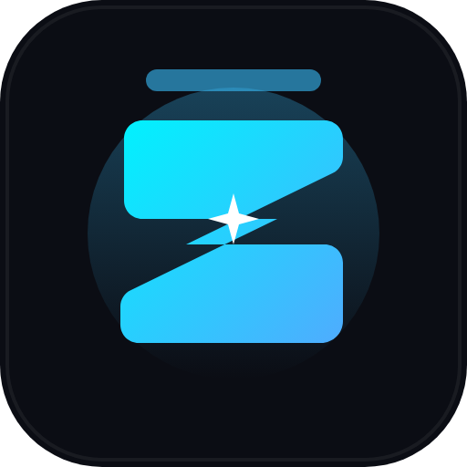

<div align="center">

  

  # Zenith 🌌

  ### The Apex Desktop Notch for Developers on Windows

  An intelligent overhead companion tracking your media, tasks, Git repository, local dev servers, and instant AI diagnostics in a sleek top-screen pill.

  <br />

  [-blue?style=flat-square&logo=windows)](https://github.com/Rangga11268/Zenith)
  [](https://github.com/Rangga11268/Zenith)
  [](LICENSE)

</div>

---

## 🌟 Key Features

* **🎵 Integrated Media Player:** Seamless controls for Spotify, Apple Music, and web browsers with real-time synchronized lyrics via LRCLIB.
* **✅ Quick Tasks & Sprint Slices:** Local, zero-friction checklist for active to-dos and focus blocks.
* **🤖 Instant AI Copilot Bar:** Floating prompt bar to diagnose stack traces, generate regex, or get code explanations without switching out of your IDE.
* **🌿 Git Context HUD:** Live telemetry showing your active working branch, uncommitted modified/untracked files, and latest commit hash.
* **⚡ Local Dev Server & Port Monitor:** Real-time port scanner (`3000`, `5173`, `8000`, `8080`, `8501`) with live status indicators and 1-click browser launch.
* **📋 Snippet & Command Shelf:** Quick drop-zone to store and copy terminal snippets, regex patterns, and scratchpad files.
* **⚡ 0% Idle Impact:** Hardware-accelerated GPU rendering that sleeps when idle, keeping CPU and battery consumption minimal.

---

## 📂 Architecture & Specifications

Zenith is developed under strict **Spec-Driven Development** principles. Detailed architecture blueprints are documented in [`docs/`](docs/):

* 📘 [**docs/PRD.md**](docs/PRD.md) — Product Requirements Document (vision, user personas, core functional specs, and success metrics).
* ⚙️ [**docs/SPEC.md**](docs/SPEC.md) — Technical Specification (Electron + React 19 + TypeScript + Vite + Tailwind CSS, IPC contracts, and subsystem designs).
* 🗺️ [**docs/TASKS.md**](docs/TASKS.md) — Vertical Slices Roadmap (Milestone 1 through 9).

---

## 🚀 Quick Start (Development)

```bash
# Clone the repository
git clone https://github.com/Rangga11268/Zenith.git
cd Zenith

# Install dependencies
npm install

# Start development mode (Hot-reload enabled)
npm run dev

# Package Windows executable
npm run build
```

---

## 📄 License
MIT © [Darell Rangga](https://github.com/Rangga11268)
